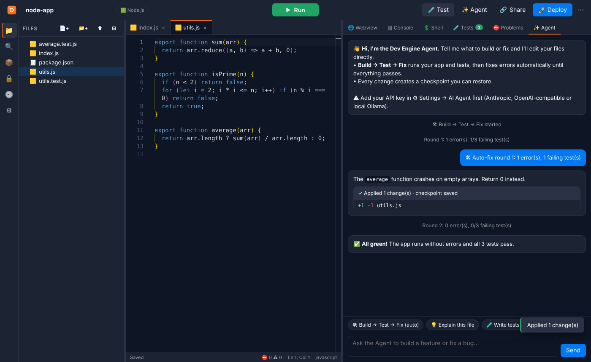
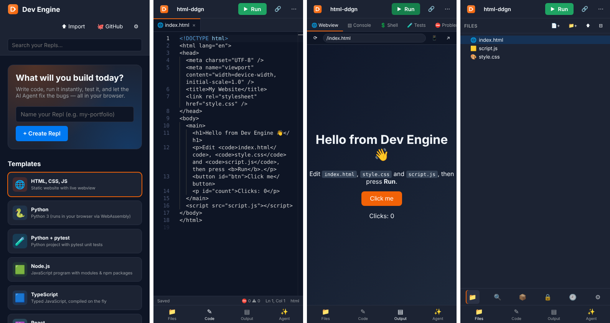

<p align="center"></p>
<h1 align="center">Dev Engine</h1>
<p align="center"><b>Build, run, test and fix software, websites and web apps — right in your browser.</b><br>
A Replit-style online IDE with an AI Agent that runs your code, runs your tests and fixes the bugs for you.</p>

<p align="center"><a href="https://myselflittle-collab.github.io/Dev-Engine/"><b>▶ Open Dev Engine</b></a></p>



## Features

| Area | What you get |
|---|---|
| **Workspace** | Replit-style layout: file tree, tabs, Monaco editor (VS Code engine), Webview, Console, Shell, Tests, Problems and Agent panes; resizable panels; mobile layout with a bottom tab bar |
| **Run** | One green **Run** button (Ctrl+Enter). HTML/CSS/JS sites in a live **Webview** with live reload · **Node.js-style** JavaScript with ES modules, CommonJS, `fs`/`path`/`events`/`readline` shims · **TypeScript & JSX/React** compiled on the fly · **Python 3** via WebAssembly (Pyodide) with `input()`, file writes, `requirements.txt` |
| **npm & pip** | Packages panel: `npm install` any package (loaded from esm.sh), `pip install` pure-Python wheels and Pyodide packages |
| **Test** | Built-in Jest-compatible runner (`describe/test/expect`, mocks, async) for `*.test.js/ts` and **pytest** for `test_*.py`, with a results tree |
| **Find bugs** | Problems pane collects TypeScript/JS diagnostics, Python syntax errors, invalid JSON, broken HTML links, runtime exceptions (mapped to `file:line`) and failing tests |
| **Fix bugs — AI Agent** | Chat with an Agent that edits your files. **Build → Test → Fix** loop runs the app + tests, sends errors to the model, applies the fix, and repeats until everything is green. Diff preview, apply/discard, "✨ Fix with Agent" on every error. Works with **Anthropic Claude, OpenAI-compatible APIs (OpenAI, OpenRouter, Groq…) or local Ollama** |
| **Checkpoints** | Automatic restore points before every Agent edit, delete and restore — diff and roll back any time |
| **Shell** | xterm.js terminal: `ls, cd, cat, echo >, mkdir, rm, mv, cp, grep, tree, run, test, python file.py, node file.js, pip/npm install`… With the backend it's a **real Linux bash** |
| **Other languages** | C, C++, Java, Go, Rust, Bash, Ruby, PHP… via the optional backend (`server/`) |
| **Secrets** | Environment variables injected as `process.env` / `os.environ`; never included in share links |
| **Share & Deploy** | Share link (fork-able), download `.zip` or a single self-contained HTML, **push to GitHub** and **deploy to GitHub Pages** from inside the IDE |
| **Import** | From a `.zip` or any public GitHub repository |
| **Config** | `.devengine` (or `.replit`) file: `run = "…"`, `entry = "…"`, `runtime = "web|node|python|server"`, `test = "…"` |
| **Extras** | Quick open (Ctrl+P), global search & replace, themes, auto-save, format on save, PWA install |

<p align="center"></p>

## Quick start

**Use it online:** open the GitHub Pages site above — everything runs in your browser, no account needed. Projects are saved in your browser's local storage (use *Settings → Backup* to export them).

**Run locally:**

```bash
git clone https://github.com/myselflittle-collab/Dev-Engine.git
cd Dev-Engine
npm start            # serves the IDE at http://localhost:8080
```

### Turn on the AI Agent
⚙ **Settings → AI Agent**: choose a provider and paste your API key (it is stored only in your browser and sent only to that provider).

- Anthropic: model e.g. `claude-sonnet-5-5`
- OpenAI-compatible: set base URL + model (OpenAI, OpenRouter, Groq, Together…)
- Ollama (free, local): `ollama serve`, then model e.g. `qwen2.5-coder` — start Ollama with `OLLAMA_ORIGINS=*` so the browser may call it

Then open the **✨ Agent** tab and press **🛠 Build → Test → Fix**.

### Optional backend (real shell + every language)

```bash
cd server && npm install && DEVENGINE_TOKEN=my-secret npm start
# or, with all compilers preinstalled:
DEVENGINE_TOKEN=my-secret docker compose up --build
```

Open `http://localhost:3001` (the server also serves the IDE) and set **Settings → Backend URL** to `http://localhost:3001?token=my-secret`.
Templates for C, C++, Java, Go, Rust and Bash use it automatically; tick *"Run this Repl on the backend"* to run Node/Python projects natively too.

> ⚠️ The backend executes whatever code the browser sends. Run it on your own machine or in Docker, and always set `DEVENGINE_TOKEN` if it is reachable by anyone else.

## Keyboard shortcuts

| Keys | Action |
|---|---|
| Ctrl/⌘ + Enter | Run |
| Ctrl/⌘ + S | Save (and format if enabled) |
| Ctrl/⌘ + P | Quick open file |
| Ctrl/⌘ + Shift + T | Run tests |
| Ctrl/⌘ + Shift + F | Search in files |
| Ctrl/⌘ + I | Ask the Agent |
| Ctrl/⌘ + B | Toggle sidebar |

## How it works

```
index.html, css/app.css      UI shell (no build step — plain ES modules)
js/app.js                    workspace, editor, panels, run/test orchestration, Agent loop
js/sandbox.js                runtime injected into a sandboxed iframe: console bridge, module loader
                             (blob-URL ESM + CommonJS), Node shims, Jest-compatible test runner
js/runner.js                 webview document builder, TypeScript/JSX transpile, static checks
js/python.js                 Pyodide runner, pytest, syntax lint, file write-back
js/shell.js                  browser shell over the virtual file system
js/ai.js                     Anthropic / OpenAI-compatible streaming client, edit-block parser
js/github.js                 import repos, push commits, enable GitHub Pages
js/backend.js + server/      optional WebSocket backend: real PTY shell + any-language runner
tests/                       unit tests (node --test)
```

User code always runs in a sandboxed, opaque-origin iframe, so it cannot read Dev Engine's storage (where your API keys live).

## Dev Engine vs Replit — honest comparison

Dev Engine reproduces Replit's day-to-day workflow (workspace layout, Run button, webview, console, shell, packages, secrets, tests, AI Agent with checkpoints, share & deploy). Things Replit does that need cloud infrastructure are different here:

- **Compute:** Replit gives every Repl a cloud Linux container. Dev Engine runs JS/TS/Python/web in your browser, and other languages on the backend *you* host.
- **Storage & accounts:** projects live in your browser (export/backup, or push to GitHub) — there are no Dev Engine accounts or cloud sync.
- **Multiplayer** real-time collaboration and hosted databases are not included.
- **Deployments** go to GitHub Pages (static sites) or wherever you take the `.zip`.
- **Python in the browser** can't open network sockets or use threads, and long loops block the tab — use the backend for those.

## Tests

```bash
npm test                 # front-end unit tests
cd server && npm test    # backend tests (spawns the server, runs bash/C/shell over WebSocket)
```

## License

MIT © Purnananda Mishra
